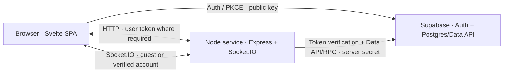

# Architecture

Clumsy Keys is a browser-rendered Svelte SPA and a separate long-running
Express/Socket.IO service. Optional Supabase Auth/Postgres provides account
identity and saved data. Guest practice and multiplayer do not require accounts.
This document describes current module ownership and data flow; the maintained
[API spec](docs/api.openapi.json) and [deployment guide](docs/DEPLOYMENT.md)
describe transport contracts and hosting configuration.

## System boundaries

The browser uses Supabase for Auth. Application account/history/leaderboard
requests go through Express. The server verifies user tokens through Supabase
Auth and derives ownership itself; request fields do not establish an account
identity. Its privileged Data API client must enforce authorization independently
of RLS. Public solo rankings have optional authentication for personal standing.

Frontend imports from the backend are limited to browser-safe contracts/types,
including race settings, persistence validation and database types. Do not import
server configuration, SDK adapters, transport handlers or Node runtime modules
into browser code. Shared presentation must not import feature stores.

## Repository map

| Location | Responsibility |
| --- | --- |
| `src/pages/` | Page composition and lightweight static pages. |
| `src/lib/features/practice/` | Prose/code input engines, sessions, settings adapters, live stats, results and solo-result retry queue. |
| `src/lib/features/settings/` | Prose configuration, shared dialogs/selectors and account preference synchronization. |
| `src/lib/features/multiplayer/` | Socket client, room/race state, lobby, recovery checkpoints, race input/results and decorative room preview. |
| `src/lib/features/auth/` | Account forms, private dashboard presentation and formatting. |
| `src/lib/features/history/` | Paginated saved practice/race history. |
| `src/lib/features/leaderboards/` | Public solo-board presentation, filter normalization and cancellable HTTP reads. |
| `src/lib/components/` | Shared layouts, decorative icons and presentational charts; pure chart-path helper. |
| `src/lib/state/` | App theme/status, account session, preference synchronization status and race-save status. |
| `src/lib/services/` | Backend URL resolution, browser Supabase Auth client, public configuration checks and account HTTP client. |
| `src/styles/` | Canonical tokens, base/focus styles, typing/layout primitives and result styles. |
| `shared/content/` | Browser-safe catalogs, selection, length classification and token modifiers used by browser and server. |
| `backend/src/` | Process/configuration, HTTP/Socket.IO boundaries, live room lifecycle and persistence adapter. |
| `supabase/` | Versioned migrations, local configuration and SQL access/aggregation tests. |
| `tests/` | Unit/HTTP/socket tests, Chrome flows, local/hosted database checks and controlled upstream-failure checks. |
| `postman/` | Local Supabase HTTP fixture and simulation context; not the application backend or a PostgreSQL implementation. |

Use explicit direct imports, focused feature modules and PascalCase Svelte
components. Domain stores may stay with their feature; app-wide identity/theme
and synchronization status belong in `state/`. There are no broad global barrels.

## Browser startup, routes and shell

`index.html` applies the saved theme before mount. `src/main.ts` initializes the
account and processes PKCE callback query parameters before dynamically importing
`App.svelte`. Account/HMR subscriptions are cleaned up. App starts preference and
solo-result synchronization, handles race-save status and clears old room state
when account identity changes.

`src/lib/Router.svelte` composes hash routes and keys route content by location:

| Hash path | Entry and purpose |
| --- | --- |
| `#/` | Prose practice. |
| `#/game` | Code snippets and keyword practice. |
| `#/login` | Guest/account room access; this is not the account sign-in page. |
| `#/race` | Multiplayer lobby or active race; missing room identity returns to room access. |
| `#/ranking` | Latest multiplayer results and saved latest round for a signed-in participant. |
| `#/leaderboard` | Public solo leaderboard. |
| `#/account` | Account access, recovery or the signed-in dashboard. |
| `#/history` | Private saved practice/race history. |
| `#/themes` | Theme selection. |
| `#/about` | About and practice-mode navigation. |

Auth returns to the root with `auth_action` and PKCE query parameters, then moves
to the account route. Hash navigation does not require a server catch-all rewrite.
The router renders one persistent header outside keyed route content; practice
layouts share active-test visibility through a shell-scoped Svelte context.
Route changes update the header mode and replace/fade only the content. The
shared page shell owns header placement and content centering. App renders
one global footer; practice and live-race views render only their contextual
shortcut rows. Long/narrow views use normal document scrolling. See
[DESIGN.md](DESIGN.md) for width, focus and responsive presentation conventions.

## Practice and content

Feature settings adapters call the pure `shared/content` pipeline: catalog,
selection, then modifiers. Catalogs contain words, complete quotes, keywords and
complete code snippets with stable IDs, source metadata and authored length
categories. Solo selection uses browser randomness; race passage generation
injects `crypto.randomInt`. Formatting policies intentionally differ by mode.
See the [content guide](shared/content/README.md) for catalog rules and provenance.

Quotes are never truncated to a word preset. Solo quote length is an optional
preference/result setting with a medium fallback; multiplayer uses its unfiltered
quote pool. Snippet restart avoids the previous ID when the category has an
alternative. Snippet length is currently local to the practice view and is not
persisted in account preferences or result settings. Neither quote nor snippet
length currently subdivides the public solo board.

`session.ts` owns pure solo metrics, retaining the historical four-character WPM
calculation. DOM typing engines intentionally mutate character-feedback nodes
and use keyed sessions to reset them. Keep calculations, input/DOM work and
transport side effects separate; reactive per-character rewrites require their
own regression work. Completion captures one immutable, account-bound result;
network writes do not enter the keyboard loop.

## Live multiplayer

The backend separates process startup (`app.ts`), environment handling
(`config.ts`), application construction (`server.ts`), public routes (`http.ts`),
Socket.IO bindings (`socket.ts`), room lifecycle (`room.services.ts`), settings
validation (`race.settings.ts`) and content adaptation (`race.passage.ts`).
`createApplication` accepts an optional persistence dependency so tests can
construct real HTTP/socket servers independently of hosted credentials.

Rooms are process-local. Racer ownership is bound to the current socket and a
server-issued resume token, independently of optional account identity. Recovery
lasts 30 seconds. All racers ready, with at least two racers, schedules a
five-second server countdown. Valid waiting-room settings changes clear votes;
new racers cannot join a playing or finished round. Joined racers can reset a
finished room for replay while preserving settings.

The server owns countdown deadlines, timed completion, sampled history and finish
timestamps. Client-reported WPM/accuracy/progress still do not prove honest typing.
Origins, packet limits, quotas and ownership checks are described in the
[API spec](docs/api.openapi.json) and [security audit](docs/SECURITY_AUDIT.md).

The room-access `RacePreview.svelte` uses the pure `race-preview.ts` animation
model. It does not connect to Socket.IO, create rooms or contribute scores.

## Accounts, persistence and public rankings

The browser receives only public Supabase configuration; the backend receives
the secret at runtime. Backend startup loads root `.env` for local use without
overriding inherited deployment variables. Supabase credentials and migration
operator credentials have separate purposes.

All application database writes go through validated backend services and
restricted RPC functions. RLS separately permits owner-scoped authenticated
reads; anonymous roles have no application-table grants. Practice summary/detail
and race/participant writes are atomic and retry-safe. Preferences use optimistic
revisions; incoming settings apply between sessions/results, and account changes
restore guest preferences.

Solo saves have an account-bound browser retry queue capped at 20 entries and
approximately 2 MB. Completed/abandoned race archives freeze the original roster
and final metrics before replay/cleanup and enter a process-local queue capped at
100 rounds with five attempts each. Process loss can discard pending writes and
all active rooms/timers/recovery sessions; confirmed database rows remain durable.

The private dashboard reads one service-only aggregate of all saved solo tests,
per-test arithmetic means, characters/time totals, bests per mode and five recent
summaries. Guest, unsaved, abandoned and multiplayer activity is excluded.
`#/history` paginates private practice and race results. The history feature owns
loaded-result filtering, metric/date sorting and CSV formatting in a pure helper;
its presentation retains the listing while inspecting result charts. Detail
reads switch to a result skeleton immediately, with independent loading/error
state and retry. Returning or changing history type invalidates pending detail
responses, so late completions cannot reopen the result. Race details
display the round’s archived settings, never current lobby settings. Summaries
and exports cover matching loaded rows, rather than account-wide aggregates.
Shared race scoreboards omit opponent account and internal participant UUIDs.

Solo leaderboards use a cancellable HTTP service and the service-only
`read_solo_leaderboard` RPC. PostgreSQL filters by family, language, format, test
length and rolling range before selecting one best result per player, ranking
and paginating ten rows. A verified viewer's standing may lie outside that page.
Public output contains display names and score fields with pseudonymous player
keys, not account UUIDs, preferences or per-word history. Runtime failures are
shown as failures; synthetic scores belong only in tests.

The [Supabase guide](docs/SUPABASE.md) lists all five migrations, setup, grants,
callbacks and database verification. Plausibility checks are not cheat resistance.

## Build and verification boundaries

The repository root is the frontend package; `backend` is the pnpm workspace
package. `shared/content` is source-only, with a CommonJS package boundary matching
the backend's TypeScript target. Vite consumes its source for the browser. Backend
compilation emits both backend and shared trees under `backend/build`; the server
entry is `backend/build/backend/src/app.js`. Docker uses repository-root context
and copies `shared` before compiling and assembling production dependencies.

Vercel publishes frontend `dist`; Northflank runs the long-lived backend with
HTTP/WebSocket support. Keep one replica until shared room coordination is
designed. Supabase does not provide live-room recovery or horizontal coordination.
The deployment workflow is currently disabled; see
[DEPLOYMENT.md](docs/DEPLOYMENT.md) before releasing or changing that policy.

Tests distinguish pure calculations, real local HTTP/Socket.IO, a modeled
Supabase HTTP dependency, real local SQL/Auth/Data API, browser behavior, and
explicit hosted checks. These establish different guarantees. The security CI
runs lint, types/documentation checks, unit/integration tests, builds, credential
scans and dependency auditing; it does not run the Chrome suite or local SQL tests.

[CONTRIBUTING.md](CONTRIBUTING.md) contains runnable contributor commands.
[SECURITY_AUDIT.md](docs/SECURITY_AUDIT.md) records actual results and unresolved
verification limits. Update this architecture when routes, ownership, module
boundaries, persistence flow or deployment packaging change.
