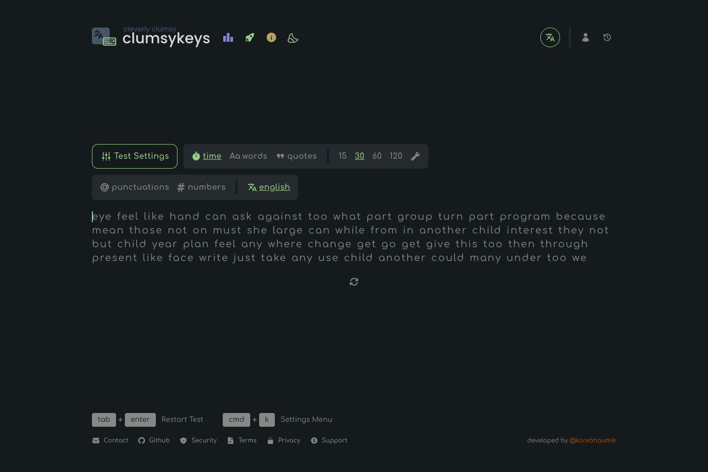
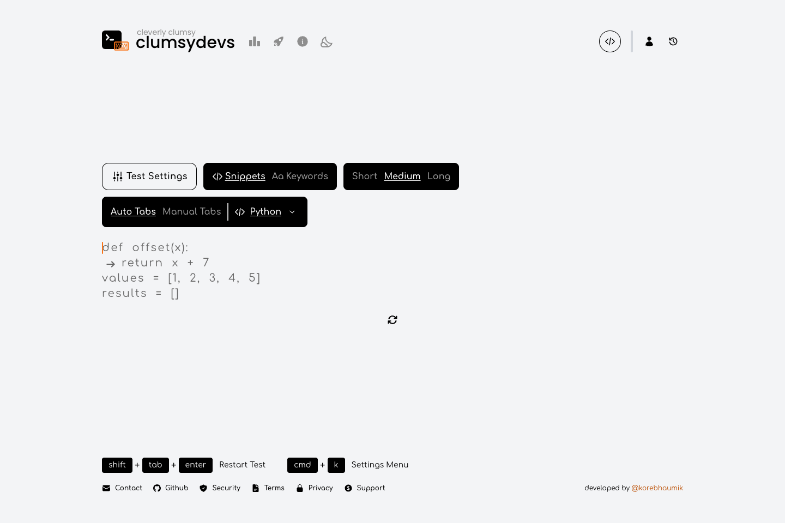
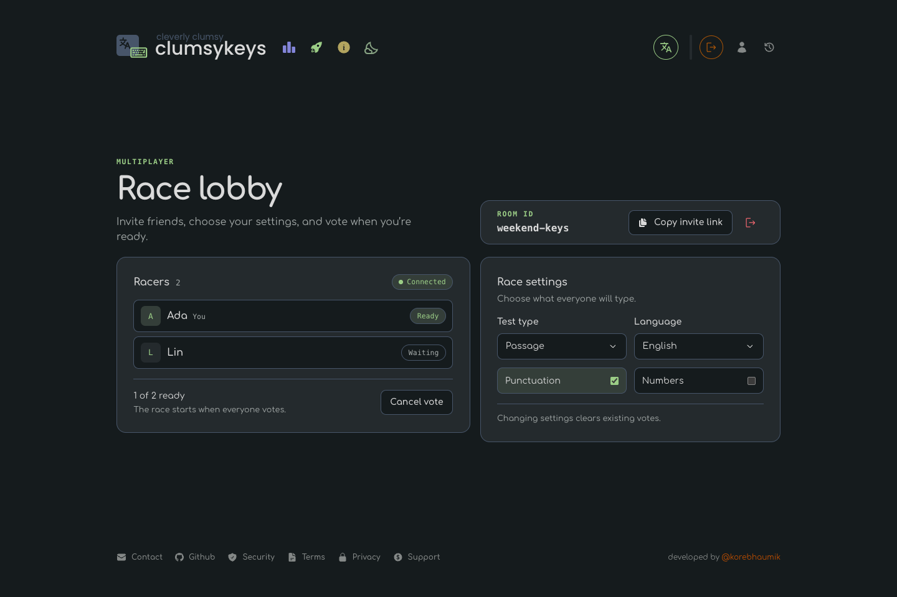
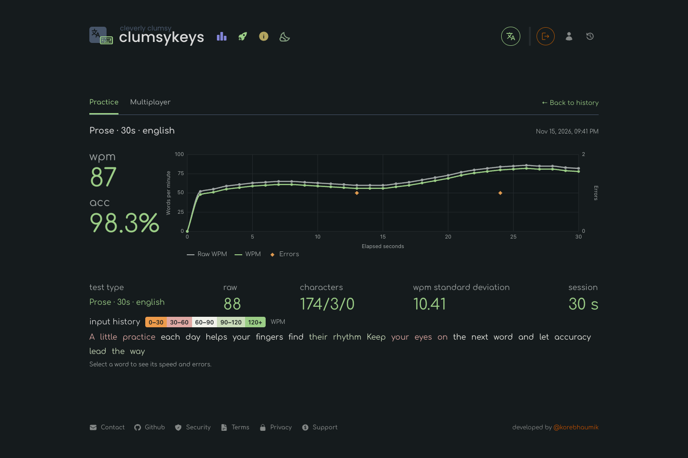
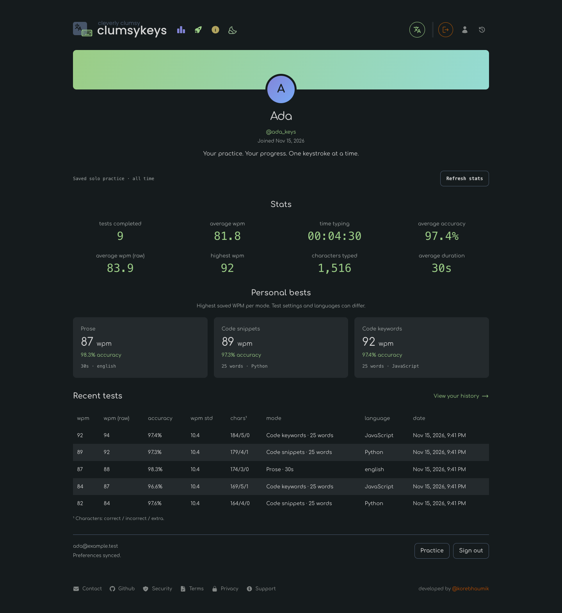
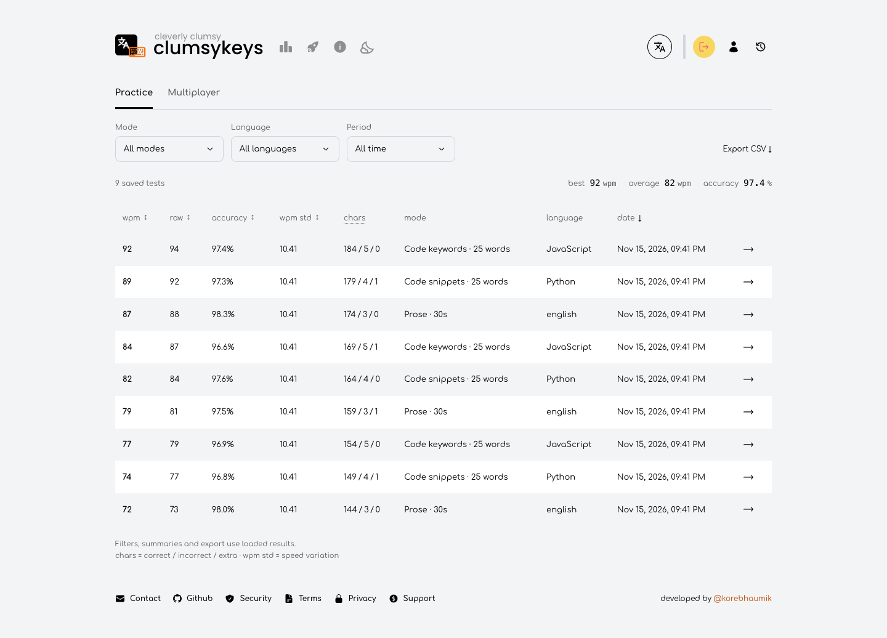
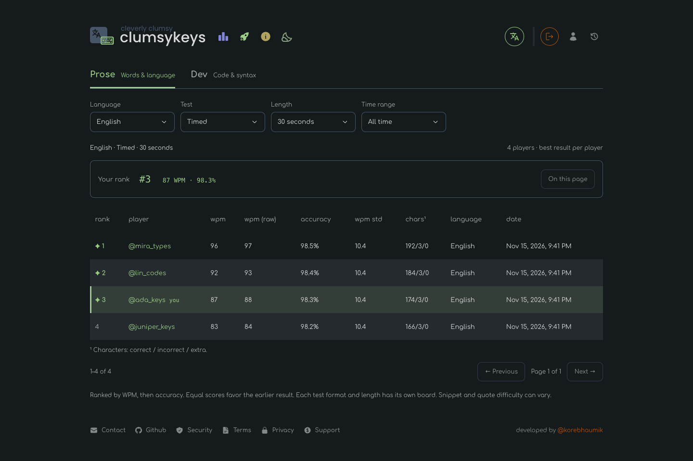

# Clumsy Keys

**Prose. Code. Multiplayer. Find your typing rhythm.**

A focused typing application for everyday practice, real code snippets, and races with friends. Start as a guest, or sign in to keep your progress across devices.

[**Try Clumsy Keys →**](https://clumsykeys.vercel.app) · [Screenshots](#see-it-in-action) · [Run locally](#run-locally) · [Contribute](CONTRIBUTING.md)



## What you can do

- **Practise prose your way.** Timed tests, word counts, and complete quotes in three lengths; English and Hinglish vocabulary, plus punctuation and number modifiers.
- **Build fluency with code.** Snippets and keyword practice for Python, JavaScript, TypeScript, Java, C++, and C, with automatic or manual indentation.
- **Race with friends.** Share a room invite, choose a shared test, vote to start, and follow live progress through results and replay.
- **Understand each result.** Review WPM, raw WPM, accuracy, character counts, speed charts, and feedback for individual words. Celebrate personal bests for each language and test category.
- **Keep your progress.** Optional email/password or GitHub sign-in, saved history with filters and CSV export, synced preferences, and public solo rankings with unique handles.
- **Make it comfortable.** Dark Forest and Classic themes, keyboard shortcuts, reduced-motion support, and layouts that adapt to smaller screens.

## See it in action

Select an image to view it at full resolution.

<table>
  <tr>
    <td width="50%" valign="top">
      <a href=".github/screenshots/code-classic.png"></a>
      <br><strong>Code practice</strong><br>Work through complete snippets or switch to keyword drills.
    </td>
    <td width="50%" valign="top">
      <a href=".github/screenshots/multiplayer-dark.png"></a>
      <br><strong>Multiplayer rooms</strong><br>Bring a friend, agree on the settings, and get ready to race.
    </td>
  </tr>
  <tr>
    <td valign="top">
      <a href=".github/screenshots/results-dark.png"></a>
      <br><strong>Detailed results</strong><br>See your speed, consistency, and where mistakes happened.
    </td>
    <td valign="top">
      <a href=".github/screenshots/account-dark.png"></a>
      <br><strong>Your account</strong><br>Track personal bests and recent practice under your own name and handle.
    </td>
  </tr>
  <tr>
    <td valign="top">
      <a href=".github/screenshots/history-classic.png"></a>
      <br><strong>Saved history</strong><br>Filter and sort saved results, open their details, or export the loaded records.
    </td>
    <td valign="top">
      <a href=".github/screenshots/leaderboard-dark.png"></a>
      <br><strong>Solo leaderboards</strong><br>Compare your best result for a specific test format, language, and length.
    </td>
  </tr>
</table>

Screenshots are captured from the actual application running locally in both themes. Account statistics, saved results, and leaderboard entries use fictional demo data.

## Run locally

Use **Node 22.12+ on the 22 line, or Node 24+**, and **pnpm 12.18.0**.

```sh
git clone https://github.com/korebhaumik/clumsykeys.git
cd clumsykeys
pnpm install --frozen-lockfile
pnpm dev:server
```

From the same directory in a second terminal:

```sh
pnpm dev
```

Open [localhost:5173](http://localhost:5173). Guest practice and multiplayer work without a Supabase account or configuration.

To enable accounts, GitHub sign-in, saved results, synced preferences, and solo leaderboards, follow the [Supabase setup guide](docs/SUPABASE.md). It covers environment variables, migrations, and authentication callbacks.

## Inside the project

- **Frontend:** Svelte 5 · TypeScript · Vite 8 · Tailwind CSS 4
- **Backend:** Express 5 · Socket.IO
- **Accounts and persistence:** Supabase Auth · PostgreSQL

[Contributor setup and checks](CONTRIBUTING.md) · [Architecture](ARCHITECTURE.md) · [Design system](DESIGN.md) · [Deployment](docs/DEPLOYMENT.md) · [API contract](docs/api.openapi.json)

Verification scope, known security limitations, and contrast measurements are maintained in the [security audit](docs/SECURITY_AUDIT.md) and [contrast report](docs/CONTRAST.md).
